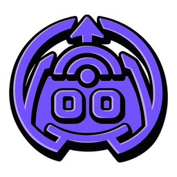
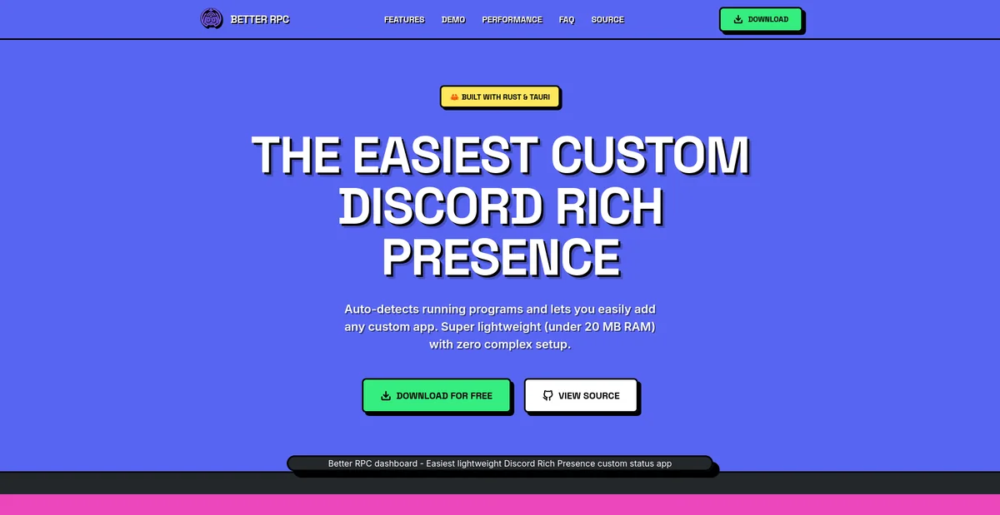
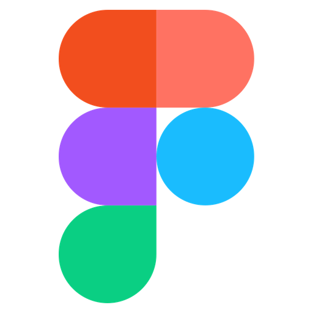
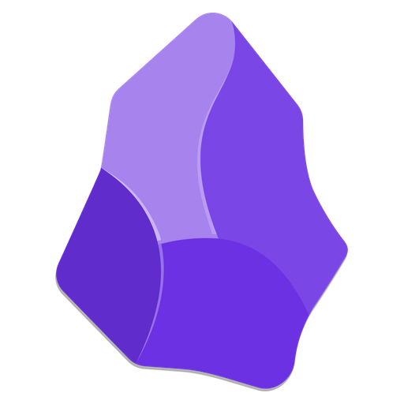
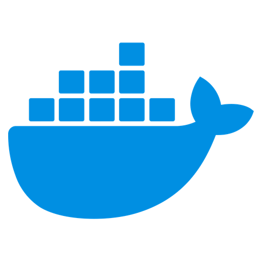
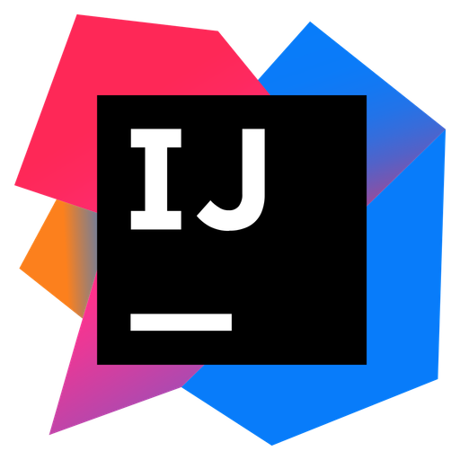
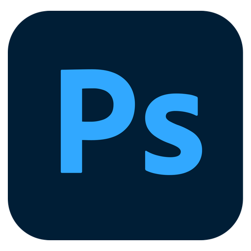
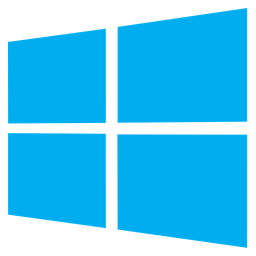

<div align="center">
  

  <h1>Better Rich Presence for Discord</h1>

  <p><strong>Automatic, ultra-lightweight Discord Rich Presence for Windows and Linux.</strong></p>

  <p>
    <a href="https://github.com/Joao-Camilo-Mallmann/Better-Rich-Presence-For-Discord/releases/latest">
      
    </a>
    <a href="https://github.com/Joao-Camilo-Mallmann/Better-Rich-Presence-For-Discord">
      
    </a>
    <a href="https://github.com/Joao-Camilo-Mallmann/Better-Rich-Presence-For-Discord/releases">
      
    </a>
    <a href="https://tauri.app/">
      
    </a>
    <a href="https://www.rust-lang.org/">
      
    </a>
    <a href="https://react.dev/">
      
    </a>
  </p>

  <p>
    <a href="https://github.com/Joao-Camilo-Mallmann/Better-Rich-Presence-For-Discord/releases/latest">Download</a>
    ·
    <a href="#features">Features</a>
    ·
    <a href="#claude-code-integration">Claude Code</a>
    ·
    <a href="#linux-support">Linux Support</a>
    ·
    <a href="#build-from-source">Build from Source</a>
  </p>

  <br />

  

  <br />
  <br />

  <p>
    &nbsp;&nbsp;
    &nbsp;&nbsp;
    &nbsp;&nbsp;
    &nbsp;&nbsp;
    &nbsp;&nbsp;
    &nbsp;&nbsp;
    &nbsp;&nbsp;
    &nbsp;&nbsp;
    &nbsp;&nbsp;
    &nbsp;&nbsp;
    &nbsp;&nbsp;
    &nbsp;&nbsp;
    &nbsp;&nbsp;
    
    <br />
    <sub>280+ pre-configured apps · 300 full-color icons</sub>
  </p>
</div>

---

## Features

| Feature | Description |
| --- | --- |
| **280+ Pre-Configured Apps & 300 Icons** | Out-of-the-box catalog (`apps.json`) with full-color brand icons sourced from theSVG ([`docs/Icons.md`](docs/Icons.md)). |
| **Claude Code Integration** | Live coding status via local HTTP lifecycle hooks with one-click setup in Settings. |
| **Windows & Linux Support** | Native Win32 detection on Windows; X11, GNOME Wayland, Hyprland, Sway, and process-scan fallback on Linux. |
| **Dynamic & Priority List Modes** | Follow the app in focus as you switch windows, or keep your highest-ranked app shown in Discord. Pick the mode at the top of the Apps tab; a tooltip explains each one. |
| **Anti-Flicker & Idle Detection** | Smooth debounced transitions and automatic idle status when you step away. |
| **Lightweight Native Core** | Built with Rust, Tauri 2, React 19, and the React Compiler for minimal CPU and memory overhead. |

---

##  Claude Code Integration

Better Rich Presence integrates directly with Claude Code using native HTTP lifecycle hooks:

- **One-click setup:** Connect or disconnect directly from **Settings**, which non-destructively updates `~/.claude/settings.json` (or `$CLAUDE_CONFIG_DIR/settings.json`).
- **Local HTTP receiver:** Listens strictly on `127.0.0.1:47892` for hook events without blocking Claude Code.
- **Privacy-safe formatting:** Displays only the active action, filename, and project folder name—never full paths, shell arguments, or prompt text.

---

##  Linux Support

| Environment | Detection & Idle Backend |
| --- | --- |
| **X11** | Active window hints (`_NET_ACTIVE_WINDOW`), idle via Mutter or `xprintidle`. |
| **GNOME Wayland** | *Focused Window D-Bus* (preferred) or *Window Calls* GNOME Shell extension; idle via Mutter `IdleMonitor`. |
| **Hyprland / Sway** | Native compositor IPC (`hyprctl` / `swaymsg`). |
| **Fallback** | Automatic process-scan mode matching enabled rules by priority when no focused-window backend is available. |

Linux builds also include a system tray menu to reopen or quit the app and XDG login autostart support (`--minimized`).

---

## Build from Source

### Prerequisites

- [Bun](https://bun.sh/) (or Node.js 18+)
- [Rust](https://www.rust-lang.org/tools/install)
- **Windows:** [Visual Studio Build Tools](https://visualstudio.microsoft.com/visual-cpp-build-tools/) with **Desktop development with C++**
- **Linux:** Tauri v2 system libraries (`libwebkit2gtk-4.1-dev`, `libayatana-appindicator3-dev`, etc., per the [Tauri prerequisites](https://v2.tauri.app/start/prerequisites/))

### Development

```bash
git clone https://github.com/Joao-Camilo-Mallmann/Better-Rich-Presence-For-Discord.git
cd Better-Rich-Presence-For-Discord
bun install
bun run tauri dev
```

### Production Build

 **Windows** (outputs NSIS installer to `src-tauri/target/release/bundle/nsis/`):

```bash
bun run tauri build
```

 **Linux** (outputs `.deb`, `.rpm`, and `.AppImage` via [`src-tauri/tauri.linux.conf.json`](src-tauri/tauri.linux.conf.json)):

```bash
bun run tauri build --config src-tauri/tauri.linux.conf.json
```

---

## Documentation

- [docs/DESIGN.md](docs/DESIGN.md) — Visual design system tokens and Neo-Brutalist Arcade UI guidelines.
- [docs/Icons.md](docs/Icons.md) — Single-source icon architecture and `thesvg` generation pipeline.
- [docs/SettingRichPresence.md](docs/SettingRichPresence.md) — Discord Rich Presence setup and configuration reference.

---

<div align="center">
  <sub>Built with Rust, Tauri, and React.</sub>
</div>
